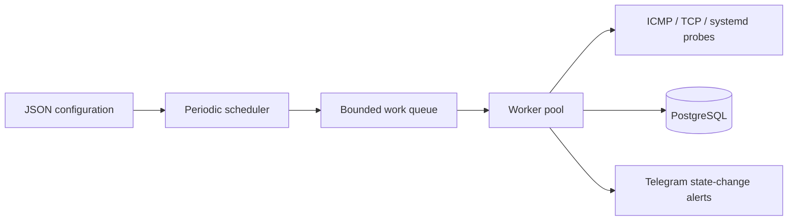

# Server Monitor

A Go service for monitoring host availability, TCP ports and local systemd services. It persists observations in PostgreSQL and sends optional Telegram alerts on availability transitions.

## Architecture



The scheduler limits concurrent checks, avoids overlapping executions of a single check and stops on process cancellation. Probes and external I/O have bounded timeouts. Local service checks are observational: they do not restart services.

## Quick start

Requirements: Go 1.23.4 (toolchain declared in go.mod), PostgreSQL, and Linux for systemd/ICMP probes. ICMP may require appropriate OS permissions.

```bash
git clone https://github.com/dharunvs/server-monitor.git
cd server-monitor
cp sample.config.json config.json
# Edit config.json with your own database and monitoring targets.
psql "$DATABASE_URL" -f queries.sql
go run ./cmd
```

For a local PostgreSQL instance without TLS only, set `MONITOR_DB_SSLMODE=disable`. Production connections should use appropriate TLS settings, preferably certificate verification. Leave the Telegram token and chat ID empty to disable alerts. Never commit your real config.

## Verification

```bash
go test -race ./...
go build -o server-monitor ./cmd
go test ./monitor -run '^$' -bench . -benchmem -count 3
```

The CI workflow runs the race detector, builds the executable and uploads benchmark output. The microbenchmark measures an in-process execution with a fake probe and sink; it is not network throughput or production latency.

## Scope and trade-offs

- Fixed-size workers bound active checks; saturated queues defer scheduling rather than creating unbounded goroutines.
- Alerts are deduplicated within a process. Durable alert state and delivery guarantees are future work.
- Remote service checks, distributed monitoring, retry persistence and retention are not implemented by this runtime.
- Legacy backup/SSH experiments are not invoked by the monitor. Do not use them in production without a separate security review.
- This is an engineering project, not a production SLA or security guarantee.
